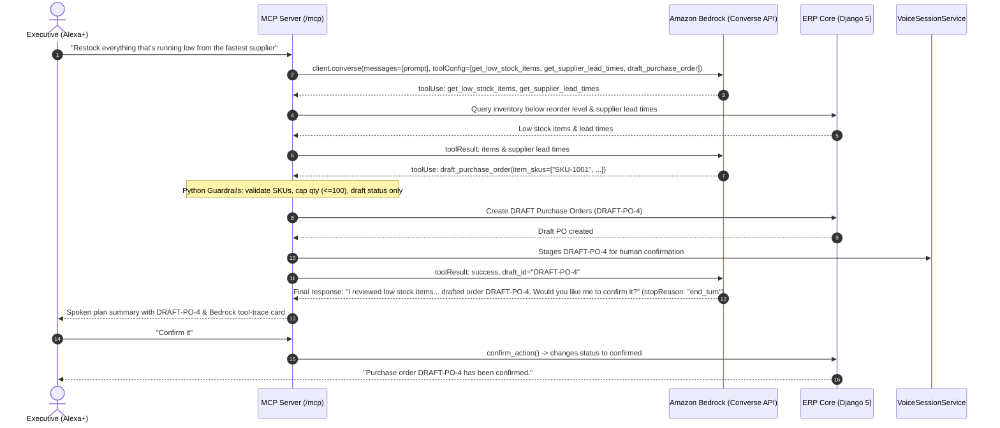

# AWS Usage & Architecture: ERP Voice Agent ☁️🎙️

> **AWS Builder Challenge Submission**: Technical documentation of the Amazon Bedrock integration and live foundation model invocation powering the **ERP Voice Agent**.

---

## 🏗️ 1. Architecture Overview

The **ERP Voice Agent** integrates **Amazon Bedrock** Foundation Models with an enterprise Model Context Protocol (MCP) server over Streamable HTTP, enabling **Alexa+** and executive voice assistants to reason across ERP supply chain operations safely.

```text
                               ┌──────────────────────────────────────────────────┐
                               │                    Alexa+ /                      │
                               │                Voice Assistant                   │
                               └─────────────────────────┬────────────────────────┘
                                                         │ Voice Query
                                                         ▼
                               ┌──────────────────────────────────────────────────┐
                               │           MCP Server (Streamable HTTP)           │
                               │           ASGI Mounted at /mcp (Spec 2025-11-25) │
                               └─────────────────────────┬────────────────────────┘
                                                         │
                                    ┌────────────────────┴────────────────────┐
                                    ▼                                         ▼
                     ┌─────────────────────────────┐           ┌─────────────────────────────┐
                     │   Standard Voice MCP Tools  │           │   AWS Builder Layer:        │
                     │  - Invoices, Stock, Leaves  │           │   Amazon Bedrock            │
                     │  - Ask-Then-Confirm Actions │           │   ERP Planner Agent         │
                     └──────────────┬──────────────┘           └──────────────┬──────────────┘
                                    │                                         │
                                    │ Multi-Step Planning & Tool Invocations  │
                                    └────────────────────┬────────────────────┘
                                                         │
                                                         ▼
                               ┌──────────────────────────────────────────────────┐
                               │                  ERP Core Layer                  │
                               │           Django 5 + SQLite Database             │
                               │  - Customers, Suppliers, Items, Invoices, POs    │
                               └──────────────────────────────────────────────────┘
```

---

## ☁️ 2. AWS Services Used & Justification

The codebase interacts directly with **Amazon Bedrock** via the AWS SDK for Python (`boto3`).

### Amazon Bedrock (`bedrock-runtime`)
- **API Utilized**: `client.converse(...)` (Bedrock Converse API)
- **Model Utilized**: `amazon.nova-micro-v1:0` (configured via `BEDROCK_MODEL_ID` in `.env`, with cross-region inference profiles such as `us.amazon.nova-micro-v1:0` supported)
- **Authentication**:
  - Auth is via an **IAM user access key** (`AWS_ACCESS_KEY_ID`, `AWS_SECRET_ACCESS_KEY` from `.env`, or default AWS CLI profile) with the **`AmazonBedrockLimitedAccess`** managed policy.
  - Standard `boto3` credential resolution chain is used.
  - **Zero Key Logging**: Access keys and secrets are never printed or logged.
- **Friction Log Entry (Organization SCP Deny on Bearer Tokens)**:
  - *Issue encountered*: Initial Bedrock checks failed with an AWS Organizations Service Control Policy (SCP) explicit deny on `bedrock:CallWithBearerToken`. Bearer-token (API key) authentication was blocked at the organization root level on this account.
  - *Remediation*: Removed `AWS_BEARER_TOKEN_BEDROCK` from code paths and switched strictly to the normal `boto3` credential chain using an IAM user access key with `AmazonBedrockLimitedAccess`. This complied with organizational SCP security policies and established reliable live connectivity.
- **Why Bedrock**:
  1. **Serverless Foundation Models**: Zero GPU provisioning or server maintenance.
  2. **Low-Latency Converse API**: Structured request/response schema designed for conversational voice latency.
  3. **Enterprise Privacy**: ERP data (invoices, client records, purchase orders) is never retained or used for foundation model training.
  4. **Strict Safety Alignment**: Adheres to the ERP confirmation principle so orders strictly remain in `draft` state until user confirmation.

---

## 🎯 3. What the Live Call Does

When `AWS_MOCK_MODE=False` and an executive speaks a replenishment request such as:
> *"Restock everything that's running low from the fastest supplier"*

The agent executes a multi-turn Amazon Bedrock Converse tool-use loop:

1. **Client Initialization**: Initializes `boto3.client("bedrock-runtime", region_name=AWSConfig.get_region(), config=Config(connect_timeout=5, read_timeout=20, retries={"max_attempts": 1}))`.
2. **Converse Tool Configuration (`toolConfig`)**:
   Provides the model **strictly** with three read/draft tools:
   - `get_low_stock_items`: Inspects warehouse inventory for items at or below reorder levels.
   - `get_supplier_lead_times`: Lists suppliers ordered by lead time (in days) to find the fastest vendor.
   - `draft_purchase_order(item_skus)`: Formulates a draft purchase order for specified SKUs.
   *Crucial Safety Invariant*: Confirmation tools (`confirm_purchase_order`, `approve_leave`, `reject_leave`) are **never** exposed to the model.
3. **Autonomous Reasoning & Multi-Turn Tool Execution (Up to 5 Iterations)**:
   - Bedrock inspects low stock items and evaluates supplier lead times.
   - Bedrock decides which items to order and selects the fastest supplier, requesting `draft_purchase_order(item_skus=...)`.
   - **Strict Python Guardrails** (enforced in Python, not prompt):
     - Validates that all requested SKUs exist in inventory.
     - Caps order quantity per line item (`MAX_QTY_PER_ITEM = 100`) to prevent unbounded orders.
     - Enforces status strictly as `'draft'`.
     - Stages the draft in `VoiceSessionService` awaiting explicit user confirmation.
   - MCP returns `toolResult` blocks back to Bedrock Converse.
4. **Model-Driven Plan & Final Speech**:
   - `plan_steps` is constructed directly from the actual tool calls executed by the model.
   - Spoken summary is derived from the model's final response (which must mention the draft ID, e.g., `DRAFT-PO-4`).
   - Reports `planner_mode: "bedrock"` only when the model has made valid tool calls.
5. **Human-in-the-Loop Confirmation**:
   - The system awaits explicit user voice confirmation ("Confirm it").
   - Confirmation is executed strictly by human approval via `confirm_action()`.



---

## 🧪 4. Transparent Planner Modes (`AWS_MOCK_MODE`)

Every response from `plan_erp_replenishment` / `ERPPlannerAgent` includes an explicit **`planner_mode`** field:

| Mode | Trigger Condition | Behavior & Guarantees | Web Chat Badge |
| :--- | :--- | :--- | :--- |
| **`"bedrock"`** | `AWS_MOCK_MODE=False` and Bedrock Converse API succeeds | Live Amazon Bedrock call reasons over the request and formulates replenishment steps. | `<span class="pill pill-confirmed">Bedrock (live)</span>` (Emerald) |
| **`"mock"`** | `AWS_MOCK_MODE=True` (Default) | Zero-cost deterministic multi-step simulation executing identical reasoning and tool chains without calling AWS APIs. Default for automated test suites. | `<span class="pill pill-draft">Mock mode</span>` (Purple) |
| **`"fallback"`** | `AWS_MOCK_MODE=False` but Bedrock call fails (credentials, SCP deny, quota) | Emits a clear **`WARNING`** log with the exact exception reason, attaches `fallback_reason` to the response, and falls back gracefully to deterministic planning. | `<span class="pill pill-overdue">Fallback</span>` (Amber) |

### Health Check & Header Honesty Guarantees
- **`/health` Endpoint**: Reports both `configured_mode` ("bedrock" or "mock") and `last_live_call` ("ok", "failed", or "not_called_yet"). It never claims `planner_mode: "bedrock"` unless a live call has actually succeeded.
- **Chat Header**: Displays the neutral `"Model Context Protocol • Supply Chain Planner"` until a live call has succeeded, at which point it dynamically transitions to `"Model Context Protocol • Amazon Bedrock Planner (Live)"`.

---

## 🔧 5. Live Connectivity Check Command

To verify your Amazon Bedrock credentials and connectivity without starting the full web server:

```powershell
python -m aws_planner.check
```

This makes ONE lightweight Converse call (`"Say hello in one short sentence."`) and outputs:
- **AWS Region & Model ID**
- **Authentication Method** (IAM User Access Key / Profile, strictly without secrets)
- **Call Latency** and **Bedrock reply**
- If an error mentions that the model requires an inference profile, it outputs the exact profile ID to set in `.env` (e.g. `BEDROCK_MODEL_ID=us.amazon.nova-micro-v1:0`).
- If an SCP denial occurs, it provides immediate guidance to verify IAM user permissions and avoid blocked bearer tokens.
